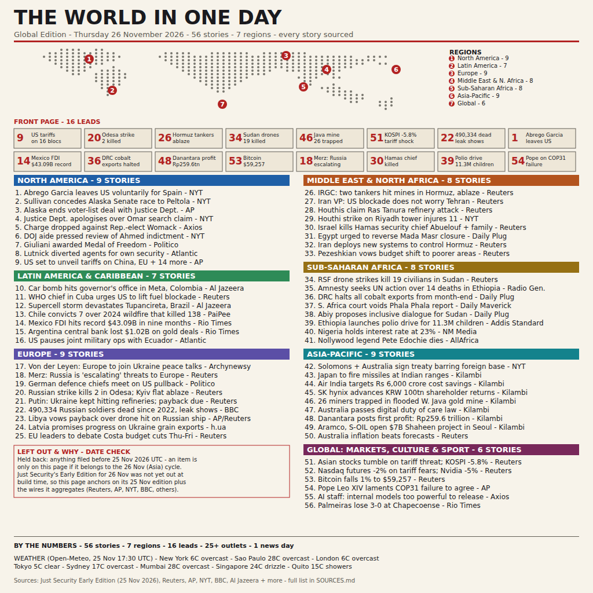

# The World in One Day — 26 November 2026

**Thursday 26 November 2026 — the whole world in one image.**

## What it is

One 1024×1024 broadsheet poster summing up 26 November 2026's world news:

- **56 numbered stories across 7 regions** (North America 9, Latin
  America & Caribbean 7, Europe 9, Middle East & North Africa 8,
  Sub-Saharan Africa 8, Asia-Pacific 9, Global: Markets, Culture &
  Sport 6), each with its outlet cited on the poster.
- **Front page — 16 leads:** the day's biggest stories pulled into a
  panel strip (US tariffs on 16 blocs, Hormuz tankers ablaze, the
  W. Java mine rescue, KOSPI −5.8%, Bitcoin at $59,257, and more).
- **Dot-matrix world map** with 7 numbered region pins + legend.
- **By-the-numbers** strip, **weather strip** (current conditions for
  8 cities, Open-Meteo) and a **"left out & why"** date-check box.

Every story belongs to the 26 November 2026 news cycle (filed 25 Nov
2026 UTC = 26 Nov in Asia), anchored on Just Security's Early Edition
for 25 Nov 2026 plus the wires it aggregates. Full verification links
are in [SOURCES.md](SOURCES.md).

## How it is built

- `build_poster.py` — authoring tool: emits `poster.svg` from the
  verified story data (the SVG is a build artifact, not committed).
- `generate.mjs` — runs `build_poster.py`, then renders the SVG to
  `entry.png` (1024×1024) with headless Chromium.
- `main.ts` — the competition program: delivers `entry.png` byte for
  byte to the output directory and verifies the copy. It renders
  nothing, so the judged output is exactly the page above.

## License

MIT — see [LICENSE](LICENSE).
